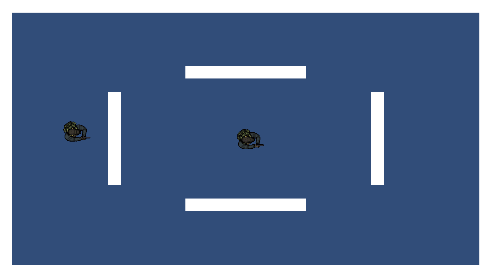
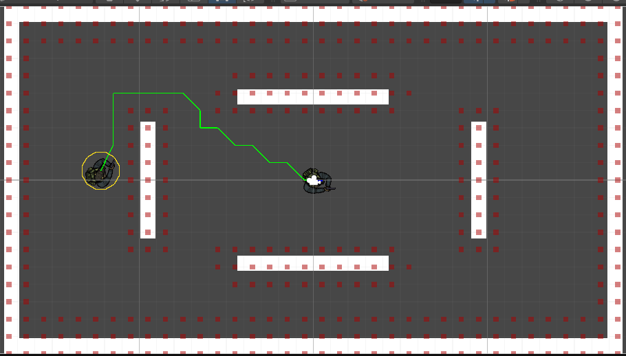
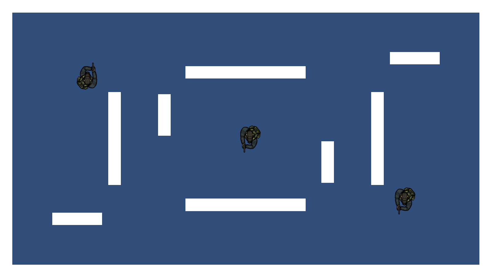
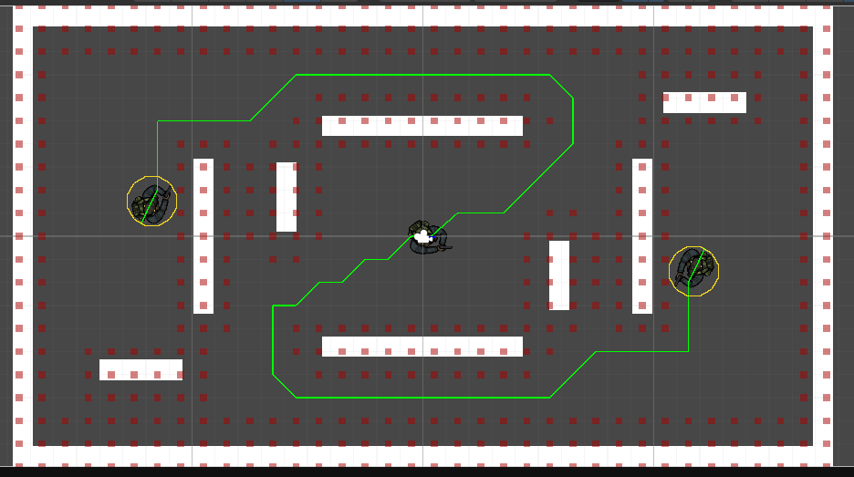
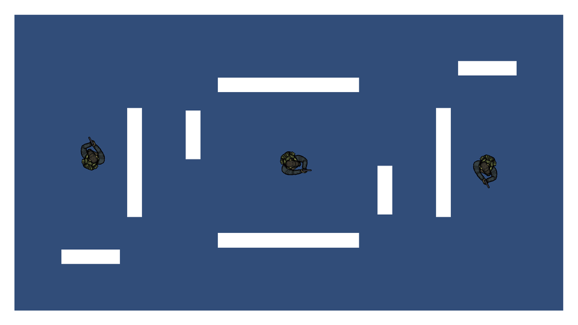
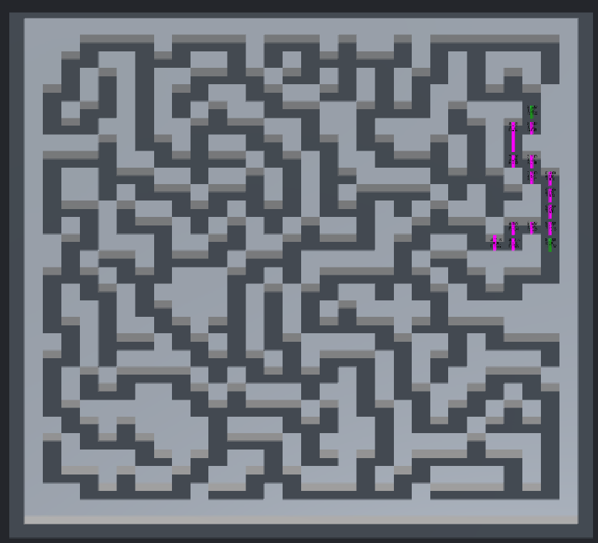
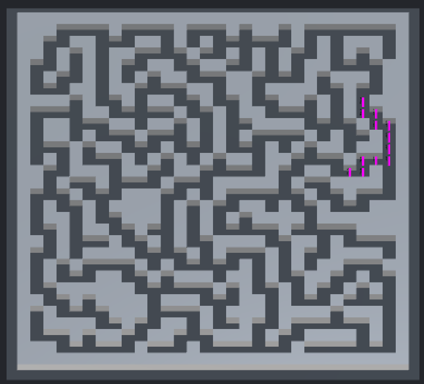

# LAB7 Pathfinding

Proyecto de Unity 6000.3.14f1 con el ejercicio resuelto 2D y los ejercicios propuestos. Las demostraciones muestran las rutas de los perseguidores y la búsqueda A* en el laberinto 3D.

## Ejercicio resuelto

El jugador se mueve y gira con las flechas. El perseguidor calcula una ruta para alcanzarlo sin atravesar las paredes. Ambos personajes tienen el mismo tamaño.

La línea verde muestra la ruta del perseguidor hacia el jugador.

## Nuevas paredes y segundo enemigo

El primer ejercicio propuesto añade cuatro paredes y un segundo perseguidor. Los dos enemigos buscan al mismo jugador y rodean los obstáculos.

En esta captura se observan las rutas de ambos perseguidores.

La animación muestra el movimiento y los giros del jugador durante la persecución.

## Tutorial The A* Algorithm

El segundo ejercicio propuesto utiliza un laberinto 3D. La tecla P selecciona el inicio y la meta, C avanza un paso de la búsqueda y M muestra la ruta final. Las capturas presentan la búsqueda y su recorrido reconstruido en el mismo laberinto.

## Abrir las escenas

Abrir la carpeta del proyecto en Unity Hub. El ejercicio resuelto está en Assets/Scenes/Pathfinding.unity. El primer ejercicio propuesto está en Assets/Scenes/PathfindingPropuesto.unity. El tutorial 3D está en Assets/Tutorial3D/Scenes/AStarPath.unity.

## Recursos

Los scripts del tutorial se basan en las soluciones guiadas S0406 y S0407 y tienen sus comentarios en español.

[Unity Learn The A* Algorithm](https://learn.unity.com/course/artificial-intelligence-for-beginners/unit/a-36369ng?version=6.0)

[A* Pathfinding Project Free de Aron Granberg](https://arongranberg.com/astar/download)

[Sprite original del personaje](https://drive.google.com/file/d/1Epzoo14fYCxe6VsyiHPyt3BMpFhn3_p-/view)
